# PO AutoFlow Enterprise
> **Production-Quality Automated Purchase Order Ingestion, Thai/English Neural OCR, Google Sheets Directory Matching & Secure Email Delivery System**

[](https://www.rust-lang.org/)
[](https://tauri.app/)
[](https://react.dev/)
[](https://github.com/PaddlePaddle/PaddleOCR)
[](https://www.sqlite.org/)
[]()

---

## 1. Executive Summary

**PO AutoFlow Enterprise** is a resilient Windows desktop application designed to fully automate Purchase Order folder ingestion, document extraction, entity classification, vendor directory matching, encrypted ZIP compression, Google Drive synchronization, and Gmail delivery via a secure Google Apps Script webhook.

The system requires **only one recurring human action**: dropping a Purchase Order folder into the designated incoming directory (`C:\PO-AutoFlow\Incoming`). Everything else—from copy-stability detection, text layer extraction, neural OCR for Thai and English, supplier classification, Google Sheets synchronization, packaging, email delivery, and transaction recording—executes autonomously in the background.

```
C:\PO-AutoFlow\Incoming\
└── PO-26002323\
    ├── PO-Invoice.pdf
    ├── Invoice.jpg
    ├── Supporting-Document.pdf
    └── Additional-Documents\
        ├── Document1.jpg
        └── Document2.pdf
```

---

## 2. System Architecture & Technical Stack

```mermaid
flowchart LR
    A["Incoming PO Folder"] --> B["Recursive Watcher (notify)"]
    B --> C["Stability Checker (Locks & Bytes)"]
    C --> D["PyMuPDF Native Text + PaddleOCR PP-OCRv5"]
    D --> E["Thai Unicode Normalizer + RapidFuzz"]
    E --> F["Google Sheets Directory Cache"]
    F --> G["ZIP Packaging + SHA-256 Checksum"]
    G --> H["Google Drive Upload"]
    H --> I["Google Apps Script + Gmail Delivery"]
    I --> J["SQLite WAL Ledger & Sent Directory"]
```



- **Desktop Framework**: Tauri 2.12 with Windows system tray, background minimize, and native OS notifications.
- **Backend Core**: Rust multi-threaded Tokio async runtime, `notify` recursive filesystem events, `rusqlite` with WAL mode.
- **Frontend Studio**: React 19, TypeScript, Vite, Tailwind CSS, Lucide icons, dark/light enterprise themes.
- **Neural OCR Engine**: Managed Python sidecar process hosting PaddleOCR PP-OCRv5 with both Thai and English models, communicating via multiplexed JSON-lines over stdin/stdout.
- **Matching & Normalization**: Unicode normalization, Sara Am unification, prefix/suffix stripping, and RapidFuzz Token Sort/Set ratios.
- **Cloud Delivery Engine**: Google Apps Script Web App endpoint authenticated with `HMAC-SHA256` signatures and idempotency keys to prevent duplicate emails.

---

## 3. Key Operational Features

1. **Autonomous Zero-Touch Operation**: Background folder watcher with configurable stability intervals that ensure files finish copying before processing starts.
2. **Crash-Resilient State Machine**: SQLite durable job queue ensures any interrupted job automatically resumes upon application restart.
3. **Advanced Thai & English OCR**: Handles scanned PDFs, photographed invoices, skewed camera captures, faded text, and multi-page documents.
4. **Supplier vs. Buyer Disambiguation**: Employs positional and keyword scoring to distinguish the vendor who should receive the PO from the customer or delivery location.
5. **Calibrated Confidence Matching**:
   - `98% - 100%`: Verified match (Auto-Sent).
   - `90% - 97%`: High confidence match (Auto-Sent if unambiguous).
   - `75% - 89%`: Review required (Routed to Review Queue).
   - `< 75%`: No match (Routed to Review Queue).
6. **Triple-Layer Duplicate Protection**: Cryptographic check on PO Number, folder fingerprint, and archive SHA-256 prevents duplicate emails.
7. **Interactive Studio & Inspector**:
   - Split-screen OCR Inspector with canvas bounding boxes overlay.
   - Live Monitor with 8-stage visual pipeline progress.
   - Review Queue with manual company overrides and one-click **"Save as Alias"** machine learning memory.
   - Comprehensive Analytics, Latency Breakdowns, and Permanent Audit Ledger.
   - 12-Step Guided Setup Onboarding Wizard.

---

## 4. Repository Layout

```
what/
├── apps-script/
│   ├── Code.gs                   # Secured Google Apps Script Web App (HMAC + Gmail)
│   └── appsscript.json           # Apps Script manifest and scopes
├── docs/
│   ├── USER_MANUAL.md            # Step-by-step user manual for office staff
│   ├── ARCHITECTURE.md           # In-depth architectural blueprint and IPC protocol
│   ├── APPS_SCRIPT_DEPLOYMENT.md # Deployment guide for Google Apps Script Webhook
│   └── TROUBLESHOOTING.md        # Complete operational troubleshooting matrix
├── ocr-worker/
│   └── worker.py                 # Persistent Python PaddleOCR PP-OCRv5 IPC worker
├── sample_data/
│   └── PO-26002323/              # Realistic synthetic Thai & English test PO folder
├── scripts/
│   └── create_sample_po.py       # Generator script for synthetic test PO datasets
├── src/                          # React + TypeScript Frontend
│   ├── components/               # Header, Sidebar, Metric Cards, Modals
│   ├── pages/                    # 9 Enterprise Views & 12-Step Setup Wizard
│   ├── services/                 # Tauri IPC Bridge and Mock Layer
│   └── types/                    # Shared TypeScript domain contracts
├── src-tauri/                    # Rust Backend (Tauri 2 Core)
│   ├── src/
│   │   ├── archive/              # ZIP archive packaging, SHA-256, integrity verification
│   │   ├── commands/             # Tauri IPC command controllers
│   │   ├── database/             # SQLite schema, WAL migrations, models, CRUD
│   │   ├── document/             # Recursive scanner, mime-type verification, SHA-256
│   │   ├── email/                # HMAC-signed Google Apps Script client
│   │   ├── google/               # Sheets directory sync and Drive upload clients
│   │   ├── matching/             # Thai Unicode normalizer and Token similarity matcher
│   │   ├── ocr/                  # Python sidecar lifecycle supervisor and IPC channel
│   │   ├── pipeline/             # 8-Stage automated workflow coordinator
│   │   ├── security/             # Path traversal validator and token masking
│   │   └── watcher/              # Recursive folder watcher and file stability verifier
│   └── tests/
│       ├── unit_tests.rs         # Unit test suite (7 comprehensive test cases)
│       └── e2e_pipeline_test.rs  # End-to-end integration test
└── package.json                  # Frontend dependencies and scripts
```

---

## 5. Getting Started & Development

### 5.1 Prerequisites
- **Operating System**: Windows 10, Windows 11, or Windows Server 2019+
- **Rust Toolchain**: Rust 1.90+ (`rustc`, `cargo`)
- **Node.js**: Node 18+ and npm
- **Python Runtime**: Python 3.10+ with the following packages:
  ```powershell
  pip install paddleocr paddlex opencv-contrib-python PyMuPDF RapidFuzz Pillow
  ```

### 5.2 Building Frontend Assets
```powershell
npm install
npm run build
```

### 5.3 Running the Full Automated Test Suite
The repository includes comprehensive unit and integration tests covering Thai normalization, token similarity algorithms, security path traversal containment, archive integrity, duplicate protection, and end-to-end folder processing:

```powershell
cd src-tauri
cargo test
```

### 5.4 Generating Synthetic Test PO Data
To generate a realistic Thai & English Purchase Order folder with nested documents (`PO-Invoice.pdf`, `Invoice.jpg`, `Supporting-Document.pdf`, etc.):

```powershell
python scripts/create_sample_po.py
```

### 5.5 Running the Desktop Application in Development
```powershell
npm run tauri dev
```

### 5.6 Compiling the Production Binary
```powershell
npm run tauri build
```
The optimized native Windows binary (`po-autoflow.exe` or `.msi` installer) will be generated under `src-tauri/target/release/`.

---

## 6. Enterprise Documentation Links

- [Non-Technical User Manual](file:///d:/oscar/Documents/what/docs/USER_MANUAL.md)
- [System Architecture & IPC Protocol Specification](file:///d:/oscar/Documents/what/docs/ARCHITECTURE.md)
- [Google Apps Script Deployment Guide](file:///d:/oscar/Documents/what/docs/APPS_SCRIPT_DEPLOYMENT.md)
- [Operational Troubleshooting Matrix](file:///d:/oscar/Documents/what/docs/TROUBLESHOOTING.md)

---

## 7. License & Compliance
Proprietary Enterprise Software. Built for secure internal enterprise procurement automation.
