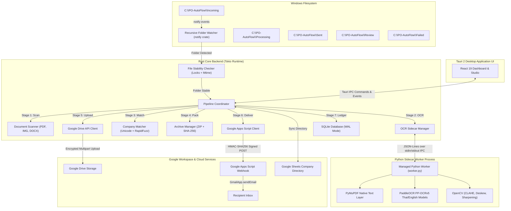

# PO AutoFlow Enterprise — System Architecture Specification

**Version:** 1.0.0 Enterprise Edition  
**Target Environment:** Windows 10/11 Desktop / Windows Server  
**Backend Runtime:** Rust (Tokio 1.43 async multi-threaded runtime)  
**Frontend Framework:** Tauri 2.12 + React 19 + TypeScript + Tailwind CSS  
**Neural Engine:** PaddleOCR PP-OCRv5 (Thai + English recognition models) via persistent Python IPC sidecar  
**Database:** SQLite 3 (WAL mode, foreign keys enforced, bundled via Rusqlite)

---

## 1. High-Level Architecture Diagram



---

## 2. Managed Sidecar Architecture & IPC Protocol

To achieve ultra-reliable, high-throughput OCR without the performance penalty of spawning Python processes per page, PO AutoFlow employs a **persistent, supervised Python sidecar**.

### 2.1 Process Lifecycle & Supervision
- **Startup**: On application launch, `OcrManager` launches `python ocr-worker/worker.py` with standard streams piped.
- **Heartbeat / Handshake**: An initial `{"command": "ping"}` request expects a `{"status": "pong", "version": "3.7.0"}` response.
- **Auto-Recovery**: If the worker process encounters a native segmentation fault or crashes, `OcrManager` automatically detects the process exit, restarts the worker, logs the event to the audit ledger, and resumes pending OCR jobs.
- **Graceful Shutdown**: On application exit, a `{"command": "shutdown"}` packet is issued before killing process trees.

### 2.2 Wire Protocol (JSON-Lines over Stdin / Stdout)
Each request is a single-line JSON string followed by `\n`. Responses are serialized identically.

**Request Schema:**
```json
{
  "command": "extract_document",
  "document_path": "C:\\PO-AutoFlow\\Incoming\\PO-26002323\\PO-Invoice.pdf",
  "force_ocr": false,
  "language_priority": ["th", "en"],
  "dpi": 300
}
```

**Response Schema:**
```json
{
  "status": "success",
  "document_path": "C:\\PO-AutoFlow\\Incoming\\PO-26002323\\PO-Invoice.pdf",
  "page_count": 1,
  "pages": [
    {
      "page_number": 1,
      "raw_text": "PURCHASE ORDER & TAX INVOICE\nSupplier / ผู้ขาย:\nบริษัท สยาม ซัพพลาย อินดัสทรี จำกัด\n...",
      "confidence": 0.962,
      "words": [
        {
          "text": "บริษัท",
          "bbox": [50, 90, 85, 105],
          "confidence": 0.985
        }
      ],
      "classified_supplier": "บริษัท สยาม ซัพพลาย อินดัสทรี จำกัด",
      "classified_buyer": "บริษัท พีโอ โฟลว์ เซ็นเตอร์ จำกัด",
      "detected_tax_id": "0105558012345",
      "detected_po_number": "PO-26002323"
    }
  ]
}
```

---

## 3. Thai & English Entity Extraction Pipeline

Supplier extraction requires distinguishing between multiple corporate entities appearing in typical procurement documents:

```
┌────────────────────────────────────────────────────────┐
│ Document Text Stream                                   │
└────────────────────────────────────────────────────────┘
                           │
                           ▼
┌────────────────────────────────────────────────────────┐
│ Pattern Recognizers                                    │
│ - Thai Corporate Prefixes: บริษัท, บจก., หจก., บ.จำกัด │
│ - English Corporate Suffixes: CO., LTD., CORP, INC.    │
│ - 13-Digit Tax ID Detector: \b\d{13}\b                 │
│ - Purchase Order Numbers: PO-\d{6,10}                  │
└────────────────────────────────────────────────────────┘
                           │
                           ▼
┌────────────────────────────────────────────────────────┐
│ Contextual Role Scoring Algorithm                      │
│ - +50 pts: Preceded by "ผู้ขาย", "Supplier", "Vendor"  │
│ - -50 pts: Preceded by "ผู้สั่งซื้อ", "Customer", "To" │
│ - +30 pts: Sits adjacent to 13-digit Tax ID            │
│ - +20 pts: Document header positioning (Y < 300)       │
└────────────────────────────────────────────────────────┘
                           │
                           ▼
┌────────────────────────────────────────────────────────┐
│ Candidate Supplier Identified                          │
└────────────────────────────────────────────────────────┘
```

---

## 4. Fuzzy Matching & Thai Normalization

The matching system matches extracted candidate names against the Google Sheets directory using a multi-step token transformation:

1. **Sara Am Unification**: Converts decomposed Nikhahit + Sara Aa (`\u0E4D\u0E32`) into unified Sara Am (`\u0E33`).
2. **Zero-Width Character Removal**: Strips `\u200B`, `\u200C`, `\u200D`, and soft hyphens.
3. **Prefix & Suffix Pruning**: Removes legal status markers (`บริษัท`, `จำกัด (มหาชน)`, `Co., Ltd.`) to isolate the unique business entity stem.
4. **Token Sort Ratio**: Word tokens are alphabetically sorted to eliminate discrepancies caused by reversed word orders.
5. **Token Set Ratio**: Matches common sub-phrases even if one party includes extra branch descriptions or divisions.
6. **Alias Table Override**: User-verified manual overrides immediately assign 100% confidence.

---

## 5. Security & Isolation Model

- **Path Traversal Containment**: All filesystem accesses are validated using `SecurityManager::validate_path_containment`. Paths resolving outside the operational root directory are rejected before any I/O executes.
- **HMAC Request Authentication**: Google Apps Script communication is cryptographically signed using `HMAC-SHA256` with timestamps to prevent replay attacks and spoofing.
- **Restricted Access Token Isolation**: Google OAuth credentials and refresh tokens are stored in the secure SQLite database and never exposed to the frontend browser context.
- **Restricted Drive Sharing**: Uploaded ZIP archives are uploaded into private enterprise folders without generating public sharing URLs.

---

## 6. Developer Options & Telemetry Architecture

PO AutoFlow Enterprise includes a dedicated diagnostic telemetry and debugging subsystem:

- **Tauri DevTools Integration**: Enabled with the `"devtools"` feature in `Cargo.toml`, allowing programmatic invocation of Chrome DevTools (`open_devtools()`) in development and release modes.
- **System Diagnostics Probe**: `get_system_diagnostics()` aggregates host OS architecture, WebView2 runtime executable path, SQLite database WAL file size, active watcher queue counts, memory lock state, and live Python OCR worker round-trip ping latency.
- **Dry-Run Simulation Pipeline**: Intercepts Drive uploads and Apps Script email delivery at runtime, producing valid simulated payloads and execution IDs to verify pipeline integrity end-to-end without dispatching real emails or consuming Gmail quotas.
- **OS File Manager Integration**: `open_path_in_explorer()` allows one-click navigation to physical storage locations from the UI.


